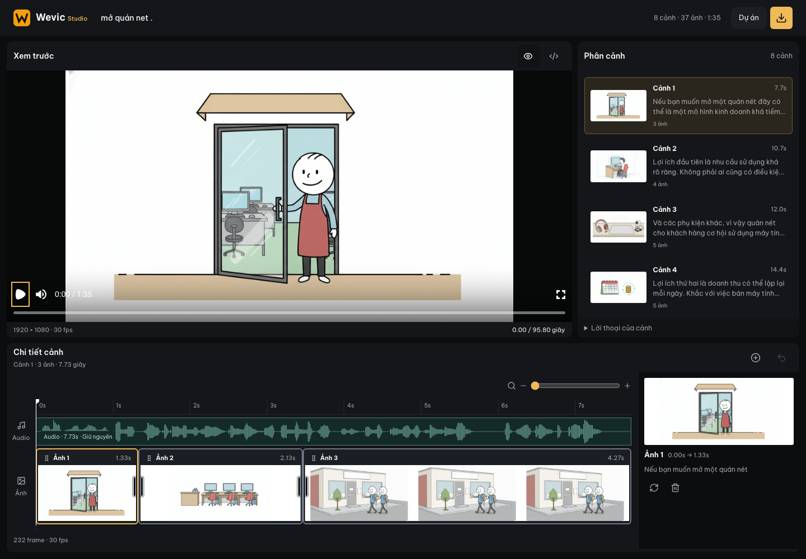
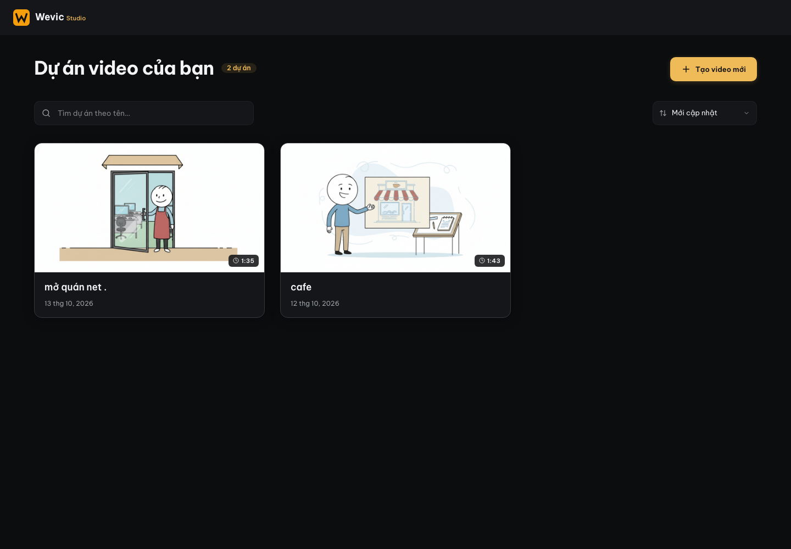
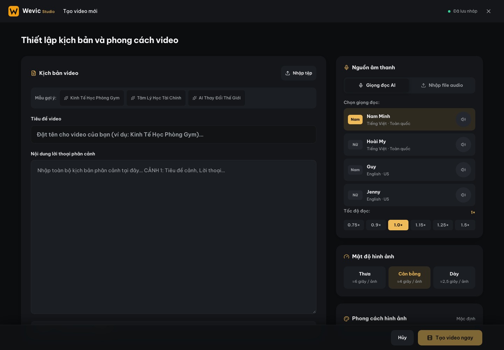

# Wevic Studio

Create and edit illustrated videos from a script or an audio recording. AI plans scenes and images, while a project-based editor lets you preview the result, adjust the timeline, and export MP4 files.

Wevic Studio currently runs locally: a React frontend, API middleware in the Vite development server, and project files and media stored on disk. This guide describes the implementation in this repository.



## Contents

- [App overview](#app-overview)
- [Requirements](#requirements)
- [Local setup](#local-setup)
- [AI configuration](#ai-configuration)
- [Using the app](#using-the-app)
- [Processing pipeline](#processing-pipeline)
- [Storage and API](#storage-and-api)
- [Source layout](#source-layout)
- [Checks and builds](#checks-and-builds)
- [Troubleshooting and limitations](#troubleshooting-and-limitations)

## App overview

Screenshots show the actual local application with existing example projects. The current interface is in Vietnamese; this README is in English.

### Project dashboard

Browse video thumbnails, search and sort projects, rename them, or delete a project after confirmation.



### Video creation

Start from narration text or imported audio. Configure the voice, speaking speed, image density, and illustration style.

The **Kiểu video** selector also offers **Hoạt hình người que · Remotion**. This mode uses ChatGPT in a visible Playwright browser to plan shots and author animated vector layers. It reuses the Leo rig, palette, lighting and motion helpers from `genvideo 2`; the reference is preserved in [STYLE_GUIDE_NGUOI_QUE.md](docs/STYLE_GUIDE_NGUOI_QUE.md). Output is 1920 × 1080 at 60 fps with 56 px letterbox bars.

Select the Remotion option, click **Mở ChatGPT đăng nhập**, complete sign-in, then click **Kiểm tra kết nối**. The application uses its own profile in `data/chatgpt-profile/`, excluded from Git. If Google rejects automated-browser sign-in, try a direct ChatGPT sign-in method available to your account; the app does not bypass provider login checks. Keep the browser open while generating. Narration and the style guide are sent to ChatGPT. An expired login, account limit or changed ChatGPT interface can interrupt generation; there is no silent fallback to image generation.

Both narration sources work in this mode. Imported audio is transcribed and aligned before cutting scenes; AI narration is generated for each planned scene. ChatGPT returns a validated scene description containing vector layers and frame-based movements. The app renders that description through Remotion rather than executing arbitrary generated JavaScript. Custom SVG shapes, grouped props, characters, camera transforms, text, steam and signal effects are supported. This does not expose all of Remotion's React API.

Remotion videos appear in the same project list. In the editor, **Chỉnh hoạt hình** opens a moving preview and controls for layer position, scale, rotation, opacity, text and expressions. You can ask ChatGPT to revise the selected shot, duplicate a shot, reorder or resize it on the timeline, undo changes, and export again. Editing preserves the scene's audio duration; shot motion scales with its new timeline duration.



### Video editor

Preview the video, select scenes, add or regenerate images, and edit their timing. Drag image clips to reorder them or drag clip edges to resize them. The timeline includes an audio waveform, zoom, and keyboard controls.

| Route | Purpose |
| --- | --- |
| `/` | Project dashboard. |
| `/project/new` | Video creation form. |
| `/project/:id` | Project editor and MP4 export. |

Edits are saved per project. Export renders the MP4 again when the timeline has changed. Creation-form drafts are stored in the browser; project data and media are stored by the local server.

## Requirements

- **Node.js:** `^20.19.0` or `>=22.12.0`, as required by the Vite 8 dependency used here.
- **npm:** installs dependencies from `package-lock.json`.
- **FFmpeg and FFprobe:** audio processing, duration measurements, and video export.
- **Python 3 and faster-whisper:** speech recognition and word timestamps for audio alignment.
- **The `edge-tts` command:** used by the AI voice-generation pipeline.
- **Playwright Chromium:** Google AI Studio automation and browser tests.
- **Access to Google AI Studio:** sign in through the browser opened by the application.

**Platform compatibility:** some commands in [videoGenerator.cjs](scripts/videoGenerator.cjs) directly reference `/opt/homebrew/bin/ffmpeg` and `/opt/homebrew/bin/ffprobe`. The full pipeline is therefore not uniformly portable across operating systems. [projectEditor.cjs](scripts/projectEditor.cjs) falls back to binaries in PATH when those Homebrew paths are unavailable, but this behavior is not implemented consistently throughout the pipeline.

## Local setup

### 1. Clone and install

```sh
git clone https://github.com/leducminh85/auto-video-gen.git
cd auto-video-gen
npm ci
npx playwright install chromium
```

### 2. Prepare audio tools

Install FFmpeg and FFprobe, then check that both commands are available:

```sh
ffmpeg -version
ffprobe -version
```

You can isolate Python dependencies in a virtual environment:

```sh
python3 -m venv .venv
source .venv/bin/activate
python -m pip install -r scripts/requirements-audio.txt
python -m pip install edge-tts
export WEVIC_PYTHON="$PWD/.venv/bin/python"
edge-tts --help
```

These activation commands use a POSIX-style shell. Start the development server from the same activated terminal so Node can find `edge-tts`.

### 3. Start the app

```sh
npm run dev
```

Open **http://localhost:5173**. The dev script binds to `0.0.0.0`, rather than loopback only.

### 4. Sign in to Google AI Studio

With the development server running, open the application's login browser through its API:

```sh
curl -X POST http://localhost:5173/api/image-provider/test-connection
```

Complete sign-in in the Chromium window opened by Playwright. The session is stored in `data/google-ai-studio-profile/`. The browser runs with a visible window (`headless: false`). The AI Studio web planning flow does not require an API key.

To inspect provider status:

```sh
curl http://localhost:5173/api/image-provider/status
```

Keep login profiles and `.env` files out of Git. These paths are covered by `.gitignore`.

## AI configuration

### Planning through Google AI Studio

[aiPlanningClient.cjs](scripts/aiPlanningClient.cjs) interacts with the AI Studio web interface through Playwright. The following are **defaults in this repository**, not a guarantee that these model IDs are available in every account:

| Environment variable | Default | Purpose |
| --- | --- | --- |
| `AI_STUDIO_PLANNING_MODEL` | `gemini-3.8-flash` | Primary planning model. |
| `AI_STUDIO_PLANNING_FALLBACK_MODEL` | `gemini-3.5-flash-lite` | Fallback planning model; an empty string disables it. |
| `AI_STUDIO_PLANNING_TIMEOUT_MS` | `180000` | Timeout per planning request, in milliseconds. |
| `WEVIC_PYTHON` | `python3` | Python executable for audio recognition and alignment. |
| `WEVIC_WHISPER_MODEL` | `small` | faster-whisper model; the current implementation uses CPU with `int8`. |

For example:

```sh
AI_STUDIO_PLANNING_TIMEOUT_MS=240000 npm run dev
```

The selected model is checked in the UI before submitting a request. Repeated internal errors, quota errors, or timeouts can activate the fallback model. Login errors, model-selection failures, and invalid responses do not automatically switch planning to an API or a locally constructed plan.

### Image models and fallback

The configured sequence in [modelFallback.cjs](scripts/image-generation/modelFallback.cjs) is:

| Order | Configured name | Model ID |
| --- | --- | --- |
| 1 | Nano Banana | `gemini-2.5-flash-image` |
| 2 | Nano Banana 2 Lite | `gemini-3.1-flash-lite-image` |
| 3 | Nano Banana 2 | `gemini-3.1-flash-image` |
| 4 | Nano Banana 2.1 | `gemini-nano-banana-2.1` |

This table documents the code's fallback configuration, not a model catalog independently verified with Google. Transient failures can trigger retries or a model change. Quota failures switch image generation to the local Flux provider. Flux handles **image generation**, not scene planning.

### Local Flux

[fluxEngine.cjs](scripts/image-generation/fluxEngine.cjs) tries a local server before the `mflux-generate` CLI:

| Setting | Default |
| --- | --- |
| `LOCAL_SD_PORT` | `7860` |
| `LOCAL_SD_API_URL` | `http://127.0.0.1:7860/sdapi/v1/txt2img` |
| Model passed to mflux | `dhairyashil/FLUX.1-schnell-mflux-4bit` |
| mflux parameters | Base model `schnell`, 4 steps, 1024 × 576 |

The local server must provide a compatible `/sdapi/v1/txt2img` endpoint and return base64 images in an `images` array. The application does not install that server or select its Flux model for you. The health check also uses `LOCAL_SD_PORT`, so configure the port consistently with the endpoint.

The mflux path uses MLX/Metal for Apple Silicon. It requires an available `mflux-generate` command and the relevant model; `npm ci` does not install them. If both Studio and local providers fail, the application reports an error rather than publishing SVG placeholders as successful AI images.

### API keys and environment files

The repository includes `.env.example`, but some comments are outdated, including the description of an SVG fallback. Use the current implementation and this guide when configuring the pipeline.

There are also code paths using `GEMINI_API_KEY` and `OPENAI_API_KEY`, with the OpenAI key supporting a DALL-E 3 branch. Neither key is a sign-in requirement for the AI Studio web workflow described above. Placeholder strings in `.env.example` are not working credentials.

## Using the app

1. Open the dashboard and select **Create new video** (`Tạo video mới`).
2. Enter a title and choose an audio source:
   - **AI voice:** enter narration text and choose a voice and speaking speed.
   - **Imported audio:** upload a recording. Any supplied script serves as optional topic context.
3. Choose image density and illustration style. The approximately 6-, 4-, or 2.5-second image intervals are pacing targets, not strict duration limits.
4. Start generation and follow its progress. On success, the application opens the new project's editor.
5. Select a scene and edit its images or timeline. To add an image, enter a description, generate a preview, then confirm insertion. Insertion splits the selected image's duration; it does not extend the audio.
6. Export or download the MP4 from the header. Timeline changes require another render to appear in the exported file.

**Undo** retains one previous editing state in the current editor session. It is not a persistent project version history.

## Processing pipeline

```text
Script → generated speech ─┐
                          ├→ narration and audio timestamps → AI scene planning
Recording → transcription ┘                                      ↓
                                                   image ideas and prompts
                                                                 ↓
                                                   validation and AI review
                                                                 ↓
                                                   images → video → project
```

- For imported audio, the transcript and audio timestamps are authoritative. A reference script is passed separately; the recording is not forced to match its wording.
- Planning requests include the full narration, scene outline, illustration style, continuity information, and previously accepted plans.
- AI selects boundaries using numbered source words. The server validates their order and reconstructs narration from the source to avoid omissions caused by incorrect indices.
- Plans undergo structural validation and AI review for fidelity, repetition, and suitability for illustration. Findings feed a bounded repair process.
- Images follow the audio boundaries and may remain visible longer or shorter than the suggested interval. Narration is not trimmed just to meet an image-density target.
- Planning metadata is stored in `metadata.ai_planning` and each scene's `planning_quality` field.

Plan review does not inspect the pixels of generated images. Review the images, audio, and final MP4 before using the result.

## Storage and API

| Path | Contents |
| --- | --- |
| `public/projects/<id>/scenes.json` | Project metadata, scenes, and timeline images. |
| `public/projects/<id>/final-video.mp4` | Project-specific MP4 export. |
| `public/images/` | Video images. |
| `public/audio/` | Source and processed audio. |
| `public/scenes.json`, `src/data/scenes.json` | Existing pipeline/fixture video data; not a replacement for project-specific storage. |
| `data/google-ai-studio-profile/` | Chromium profile with the Studio session. |

The legacy video is migrated into project storage once. Deleting a project removes its JSON and MP4, while shared source images and audio remain. Backups must include referenced media as well as project JSON.

The main API routes are registered in [vite.config.ts](vite.config.ts):

| Method | Endpoint | Purpose |
| --- | --- | --- |
| GET | `/api/projects` | List projects. |
| GET | `/api/projects/:id` | Read a project. |
| POST | `/api/projects/:id` | Save editor data. |
| PATCH | `/api/projects/:id` | Rename with `{ "title": "New title" }`. |
| DELETE | `/api/projects/:id` | Delete a project. |
| POST | `/api/projects/:id/render` | Save and render MP4. |
| GET / HEAD | `/projects/:id/final-video.mp4` | Serve MP4 with byte-range support. |
| POST | `/api/generate-video` | Run video generation. |
| POST | `/api/regenerate-beat` | Generate an image. |
| POST | `/api/audio/import` | Import audio. |
| GET | `/api/image-provider/status` | Inspect provider status. |
| POST | `/api/image-provider/test-connection` | Open the Studio sign-in browser. |

## Source layout

```text
src/
  ProjectPages.tsx             Dashboard and project navigation
  App.tsx                      Video editor
  components/                  Creation form, timeline, dialogs, header
  config/imageStyle.json       Default image style
  utils/                       Beat editing, dialog behavior, utilities
  studio-design.css            Studio styling
scripts/
  videoGenerator.cjs           Video-generation pipeline
  aiPlanningClient.cjs         AI Studio planning client
  aiProductionPlanner.cjs      Scene/image planning and review
  image-generation/           Image providers, browser, fallback
  alignAudio.py                Transcription and word timestamps
  projectStore.cjs             Project storage
  projectEditor.cjs            Audio processing, saving, rendering
  *.test.cjs                   Node and Playwright tests
docs/images/                   Application screenshots for this README
vite.config.ts                 Vite configuration and local API
```

The UI uses React, TypeScript, Vite, and Lucide. Remotion Player provides the preview; project-editor exports use FFmpeg. Be Vietnam Pro fonts are served from a local dependency.

## Checks and builds

```sh
npm run lint
npm run build
```

`lint` runs `tsc --noEmit` for type checking, not ESLint. `build` writes the frontend to `dist/`.

Run selected tests directly:

```sh
node --test scripts/aiPlanningClient.test.cjs scripts/aiProductionPlanner.test.cjs scripts/audioAlignment.test.cjs
node --test scripts/projectStore.test.cjs scripts/projectEditor.test.cjs
node --test scripts/remotion.test.cjs
node --test scripts/image-generation/modelFallback.test.cjs scripts/image-generation/fluxFallback.test.cjs
```

Some rendering tests require FFmpeg. Browser tests require Playwright Chromium. Older browser scripts may assume port 3000; adjust their URL to the dev server on port 5173 before running them, for example:

```sh
node scripts/studio-timeline.test.cjs
node scripts/studio-editor.test.cjs
node scripts/project-pages.test.cjs
```

Browser scripts use different fixtures: some mock API responses, while others create and delete temporary projects or render actual files. Read each script before running it against a working environment. UI selectors may need updating as the interface changes; listing a command here does not assert that the entire suite currently passes.

For the Remotion mode, `node scripts/remotion-render-smoke.cjs` renders a two-second fixture with audio into `data/remotion-smoke/` and checks its frame count and format. Then `node scripts/remotion-ui.test.cjs` checks creation and editing against mocked API responses on port 5173 (override with `STUDIO_URL`). These checks do not establish that a live ChatGPT account is authenticated or that its current UI still matches the browser adapter.

To inspect a real AI plan without generating images:

```sh
node scripts/previewAIPlan.cjs public/scenes.json /tmp/ai-plan-review.json
```

This command uses the signed-in Studio profile and sends AI requests. Close the application's Studio browser before running this standalone process to avoid opening the same profile twice. Preview timing is estimated; production uses actual audio alignment. A finished report has `complete: true`; interrupted runs may contain only partial results.

## Troubleshooting and limitations

| Symptom | What to check |
| --- | --- |
| Chromium does not open | Install it with `npx playwright install chromium`; use an environment with a graphical session; check whether another process holds the profile. |
| Studio asks for sign-in | Open the sign-in endpoint and complete login in the application's Playwright profile. |
| Model selection fails | Match the configured model ID to a model actually available in your account. |
| Image quota is exhausted | Check the local server or `mflux-generate`; local fallback must be installed and ready beforehand. |
| Audio recognition dependencies are missing | Install `scripts/requirements-audio.txt` with the Python executable selected by `WEVIC_PYTHON`. |
| FFmpeg/FFprobe cannot be found | Check PATH and the `/opt/homebrew/bin/` paths still used by the pipeline. |
| A project has missing images or audio | Generated media is excluded from Git. Restore the referenced media from a backup or create a new project. |
| MP4 does not reflect edits | Export again from the project editor after changing the timeline. |

**Deployment:** the API is implemented in Vite's `configureServer` hook. `npm run preview` serves the frontend build; it does not replace the development backend or provide the full video pipeline. Deploying `dist/` alone to static hosting is insufficient. A deployment needs the backend, processing tools, storage, and browser environment as well.

The repository does not implement user accounts or access controls for these local APIs. The development server is not a ready-made public multi-user service.

The animation pipeline, keyframe schema, reference study and authored IQ storyboard are documented in [REMOTION_CHOREOGRAPHY.md](docs/REMOTION_CHOREOGRAPHY.md).
